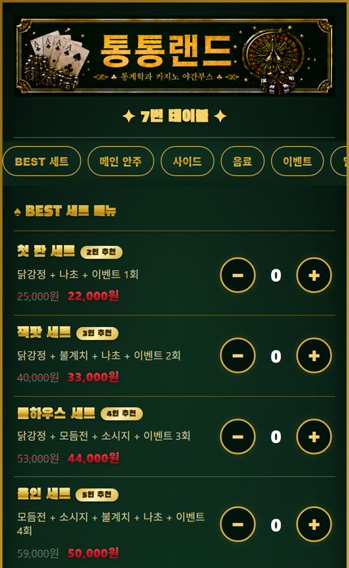

# 통통랜드 QR 주문 · 학과 축제 주점 주문·결제 웹서비스

> 테이블 QR로 주문하고, 계좌이체 입금 확인부터 주방 전달까지 한 화면에서 관리하는 축제 주점용 웹서비스
> 개인 프로젝트 (기획·개발·운영, 구현은 AI 도구와 협업) · 2026.05 (운영 5/28)

**핵심 결과**: 학과 축제 당일 실제 운영, 유료 주문 124건 처리. 운영 데이터로 피크 시간 적체와 전달 소요 시간 분석
**원본**: 코드 저장소는 비공개입니다.

---

## 1. 문제

축제 주점은 짧은 시간에 주문이 몰리고 결제는 계좌이체라, 주문 누락을 줄이고 입금 확인과 주방 전달을 단순하게 만드는 것이 운영의 핵심이었습니다.
손님은 앱 설치 없이 QR로 주문하고, 운영진은 입금 확인과 주방 전달을 실시간으로 관리할 수 있게 만드는 것을 목표로 했습니다.

## 2. 구성

| 영역 | 내용 |
|---|---|
| 화면 | React (고객 메뉴판, 주문 상태, 관리자, 주방 4개 화면) |
| 데이터 | Firebase Firestore 실시간 동기화 |
| 배포 | Vercel |
| 분석 | Python (운영 주문 데이터 집계) |

## 3. 접근

- **주문 흐름**: 주문 → 입금 대기 → 입금 확인 요청 → 관리자 입금 확인 → 주방 표시 → 전달 완료. 자동 입금 확인 없이 관리자가 확인해야만 주방에 뜨도록 설계
- **실시간 동기화**: 주문 처리 속도가 관건이라 Firestore 실시간 구독으로 관리자·주방 화면을 동시에 갱신
- **오조작 방지**: 운영 중 직원이 버튼을 잘못 눌러 주문이 처리 완료로 넘어가는 실수가 생겨, 전달 완료 확인 팝업 등 방지 장치 추가
- **재사용 구조**: 이후 다른 행사에도 쓸 수 있게 주문 로직과 화면 테마를 분리 (테마 4종)

## 4. 내 역할

혼자 진행한 프로젝트로, 다음을 모두 맡았습니다.

- 운영 문제 정의와 기능·화면·운영 방식 기획
- 실시간 DB(Firebase) 도입 결정, 고객·관리자·주방 화면 구현
- 축제 당일 현장 운영, 오조작 방지 장치 추가
- 운영 데이터 분석 (메뉴, 피크 시간, 전달 소요 시간)
- 테마형 구조로 개편, 친구와 테마 협업

## 5. 결과

| 항목 | 결과 |
|---|---|
| 처리 주문 | 유료 주문 124건 (호출 버튼 29건 별도) |
| 피크 시간 | 18시, 전체 주문의 34% |
| 주문~전달 소요 | 중앙값 27.5분, 최대 112.8분 |
| 취소율 | 12.1% (대부분 입금 전 취소) |

## 6. 한계

- 하루 운영 데이터라 개선 효과는 다음 행사에서 확인하지 못했습니다.
- 입금 확인은 여전히 사람이 계좌를 보고 해야 합니다.
